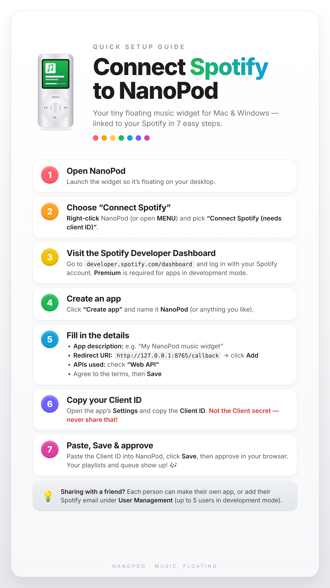

# NanoPod

A tiny floating iPod-style music widget for **Mac** and **Windows**.

Made by **Isabelle Avena**. Friends: please don’t redistribute as your own — share this Releases page instead.

NanoPod is © 2026 Isabelle Avena, all rights reserved (personal use / friends download only).

## Download

**[Download for Mac](https://github.com/IAvena/nanopod/releases/download/v0.1.0/NanoPod-mac.zip)** — Apple Silicon, macOS 13+. First open: right-click → **Open**

**[Download for Windows](https://github.com/IAvena/nanopod/releases/download/v0.1.0/NanoPod-win.zip)** — Windows x64. Unzip → run `NanoPod.exe`. SmartScreen → More info → Run anyway

Other versions are on **[Releases](https://github.com/IAvena/nanopod/releases)**.

## Install

### Mac
1. Unzip `NanoPod-mac.zip`
2. Drag `NanoPod.app` into **Applications**
3. Right-click → **Open** the first time (it’s not App Store–signed)

### Windows
1. Unzip `NanoPod-win.zip`
2. Run `NanoPod.exe`
3. If SmartScreen appears: **More info** → **Run anyway**

## Connect Spotify (playlists & queue)

Now-playing / basic controls can work without this. **Playlists and queue** need your own free Spotify Developer **Client ID**.

### Steps

1. Open NanoPod so it’s floating on your desktop.
2. Right-click NanoPod (or open **MENU**) → **Connect Spotify (needs client ID)**.
3. Go to [developer.spotify.com/dashboard](https://developer.spotify.com/dashboard) and log in. Spotify Premium is required for apps in development mode.
4. Click **Create app** and name it NanoPod (or anything you like).
5. Fill in:
   - **App description:** e.g. `My NanoPod music widget`
   - **Redirect URI:** `http://127.0.0.1:8765/callback` → **Add**
   - **APIs used:** check **Web API**
   - Agree to the terms → **Save**
6. Open the app’s **Settings** and copy the **Client ID** only — **not** the Client secret.
7. Paste the Client ID into NanoPod → **Save** → approve in your browser.

**Sharing tip:** Each person should make their own Spotify app, *or* you can add their Spotify email under **User Management** (limited seats in development mode).

Creating a Spotify Developer app only unlocks API access for *you*. It does **not** mean you made NanoPod.

## My Music (local files)

Use **My Music** in the menu for local MP3/M4A files — no Spotify Client ID needed.

## Support

Questions → ping Isabelle. Please don’t claim you built this 💛
